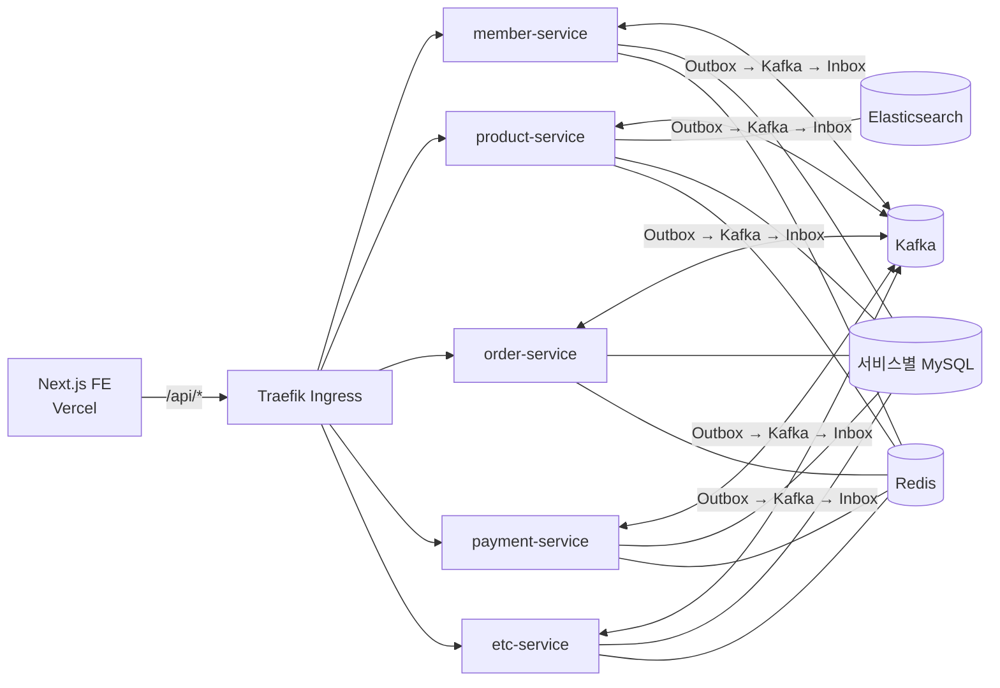

# CartMate Backend

장바구니를 함께 채우는 공동구매 커머스 **CartMate**의 백엔드입니다. 도메인별로 5개 서비스로 나눈 MSA 구조입니다.

> 이 저장소는 프로그래머스 데브코스 팀 프로젝트 **CartMate**의 미러입니다.
> 원본: [prgrms-be-adv-devcourse/beadv8_7_CartMate_BE](https://github.com/prgrms-be-adv-devcourse/beadv8_7_CartMate_BE) · 커밋 기록은 원본 그대로입니다.
> 프론트엔드: [XeXyeon/beadv8_7_CartMate_FE](https://github.com/XeXyeon/beadv8_7_CartMate_FE)

## 서비스 소개

CartMate는 사람들이 장바구니에 담아 둔 상품을 모아 공동구매로 묶어 주는 커머스입니다.

- **수요 공동구매:** 여러 회원의 장바구니에 같은(또는 비슷한) 상품이 쌓이면 관리자가 공동구매를 열고, 담아 둔 회원이 내 장바구니로 바로 참여합니다. 비슷한 상품은 상품 벡터와 LLM 종류 라벨로 찾습니다.
- **개인물품 · 공동물품 공동구매:** 회원이 직접 공동구매를 열어 함께 살 사람을 모읍니다.
- **페이백:** 공동구매가 목표 수량을 넘기면 구매확정 뒤 참여자에게 예치금으로 일부를 돌려줍니다.
- **어뷰징 방지:** 방장 취소 · 이탈 · 미결제 · 동시 참여 같은 신호를 모아 점수를 매기고, 같은 연락처 · 배송지로 묶인 계정까지 함께 제한합니다.
- **판매자 신뢰도:** 배송 · 클레임 기록으로 판매자 신뢰 점수를 매깁니다.

## 아키텍처



| 모듈 | 내용 |
|---|---|
| `member-service` | 회원 · 인증(JWT · MFA · 신뢰 기기) · 판매자 · 탈퇴 |
| `product-service` | 판매글 · 상품 · 검색(Elasticsearch) · 쿠폰 · 페이백 |
| `order-service` | 장바구니 · 공동구매 · 주문 · 어뷰징 탐지 · 수요 매칭 |
| `payment-service` | 결제(토스페이먼츠) · 예치금 지갑 · 지급 |
| `etc-service` | 배송 · 취소/반품 클레임 · 판매자 신뢰도 · 공지 |
| `common` | 예외 · 응답 · 보안 · Outbox · 분산 락 · 내부 API 클라이언트 · 서비스 간 이벤트 계약 |
| `ai-service` | AI 서버 골격 |

### 설계 포인트
- **서비스 간 데이터 일관성:** 상태 변경과 이벤트를 같은 트랜잭션에 Outbox로 기록하고 릴레이가 Kafka로 보냅니다. 받는 쪽은 Inbox에 먼저 저장해 리스너가 실패해도 유실되지 않고, 재시도 · DLT로 처리합니다. 실패 시 보상 이벤트로 되돌립니다.
- **동시성:** 지갑 충전 · 정산 지급 · 배송 · 클레임은 Redisson 분산 락, 여러 Pod에서 도는 스케줄러는 ShedLock으로 한 번만 실행합니다.
- **읽기 모델:** 장바구니 현황판처럼 다른 서비스 데이터가 필요한 화면은 이벤트로 채운 사본 테이블을 읽습니다.
- **조회 성능:** QueryDSL 배치 조회로 N+1을 줄이고, 판매글 상세는 재고 구성만 캐시합니다.

## 기술 스택
- **언어 · 프레임워크:** Java 25 · Spring Boot 4.1 · Spring Security · JPA · QueryDSL
- **데이터:** MySQL 8.4(서비스별 DB) · Redis 7(Redisson) · Elasticsearch 9 · Kafka 4
- **배치 · 동시성:** ShedLock · Redisson 분산 락
- **AI:** 상품 임베딩 · LLM 종류 라벨로 비슷한 상품 매칭
- **문서:** springdoc OpenAPI (FE가 이 문서로 API 코드를 생성)
- **테스트:** JUnit 5 · Testcontainers(MySQL · Kafka)
- **인프라:** k3s(Kubernetes) · Traefik · Docker · GitHub Actions CI/CD · Gemini 코드 리뷰
- **관측:** Alloy → Loki(로그) · Tempo(trace) → Grafana, 운영은 Grafana Cloud (`observability/`)

## 배포

- PR마다 CI가 빌드 · 테스트를 돌리고, main에서 CI가 통과하면 CD가 바뀐 서비스만 이미지로 만들어 k3s에 배포합니다(`.github/workflows/`).
- 매니페스트는 kustomize로 관리합니다(`k8s/`, 인프라는 `k8s/infra/`).
- 특정 서비스를 원하는 태그로 배포하거나 되돌릴 때는 CD를 수동 실행합니다.

## 팀

| 이름 | GitHub | 백엔드 | 프론트엔드 |
|---|---|---|---|
| 박제현 | [@XeXyeon](https://github.com/XeXyeon) | 주문 서비스(장바구니 · 공동구매 · 주문), 어뷰징 탐지, 페이백, 장바구니 수요 매칭(벡터 · LLM), Outbox → Kafka 연결 기반 · Inbox | 공동구매, 장바구니 · 주문 · 주문 상세, 예치금, 상품 상세, 공통 기반 · UI 통일 |
| 신동원 | [@sdw51](https://github.com/sdw51) | 배송 · 정산(etc 서비스), 클레임(취소 · 반품) · 환불, 검색, 결제 · 지급 | 판매자 취소/반품 · 정산 · 배송, 주문 취소, 예치금, 검색 |
| 김태수 | [@Ktaesu](https://github.com/Ktaesu) | 회원 · 인증(MFA · 신뢰 기기 · 탈퇴), 예치금, 쿠폰, 관측 스택(Loki · Tempo · Grafana) | 회원정보, 관리자 회원 · 판매글, 공동 주문 결제, 쿠폰 |
| 김산 | [@rlatks1217](https://github.com/rlatks1217) | 상품 서비스(판매글 · 상품 · 이벤트), 인프라(k3s · Docker · CI/CD), 성능 튜닝 | 판매자 상품 관리, 상품 상세 리뷰 · 댓글, CI · Vercel 배포 |

## 빌드 · 실행

```bash
./gradlew build                     # 전체 빌드 · 테스트
./gradlew :order-service:bootRun    # 서비스 하나 실행
docker compose -f observability/docker-compose.yaml up -d   # 로컬 관측 스택
```

환경 변수는 `.env.example`을 참고합니다. ERD는 `docs/erd/`, 관리자 OTP 보안 설계는 `docs/security/`에 있습니다.
